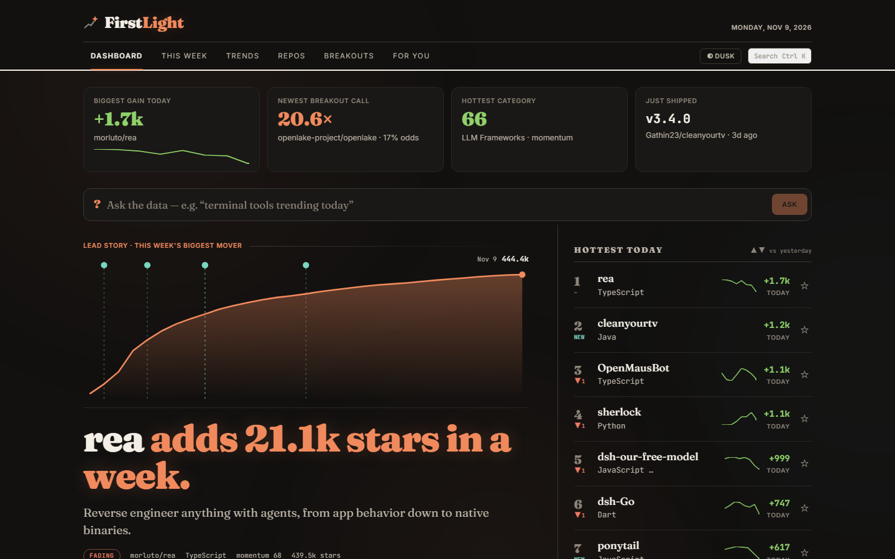
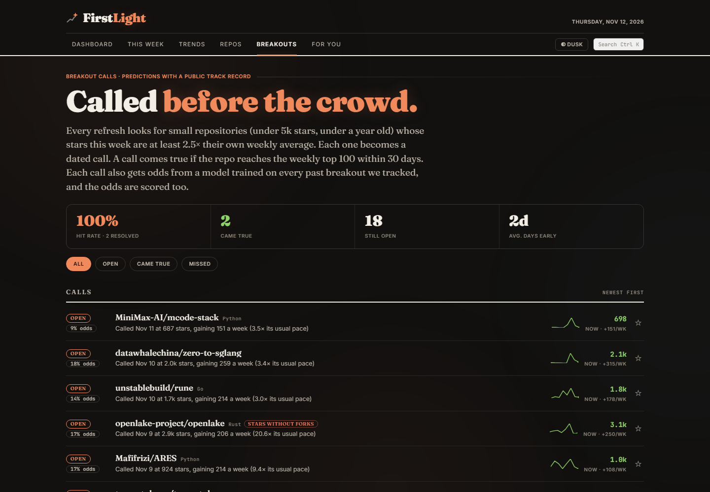

# FirstLight: See Open Source Early

A tracker for trending GitHub repositories that tries to answer the questions a star count can't. Every six hours it pulls the repositories climbing GitHub, scores them by how fast they are growing rather than how big they are, and groups them into technology categories. Then it goes further than a leaderboard: it makes dated predictions about which small repositories are breaking out and publishes how often those predictions come true, finds the day a repository's stars jumped and looks for what set it off, flags stars that arrive without the forks real interest brings, measures how quickly hype fades once a repository has its big week, and writes an AI analysis of the fastest risers. A weekly email sums it all up.

Built with Next.js, React and FastAPI on PostgreSQL and Redis, fed by the GitHub API, Hacker News, Lobsters and Bluesky, with AI write-ups from a Groq-hosted model (or a local one through Ollama) and the whole pipeline scheduled by GitHub Actions.

> **What it's for:** spotting the open source projects worth watching before they are everywhere, and knowing why they are rising, whether the attention is real and whether it is likely to last.

**Live demo:** [firstlight-oss.vercel.app](https://firstlight-oss.vercel.app)





---

## Disclaimer

**FirstLight is a learning project, not investment, hiring or security advice.** Momentum scores, breakout odds, spike explanations and star checks are heuristics built on public data and can be wrong. A repository flagged "stars without forks" is not proven to have bought stars, and a repository with no flag is not proven clean. The AI write-ups are generated text and can contain mistakes. Check anything that matters on the repository itself. See Honest Limitations for the specifics.

---

## Findings

Real problems found while building and running this, and what changed:

- **The AI write-ups failed silently for about 80 days.** Groq retired both Llama models the app used on August 16, 2026. Every insight call returned a 404, the refresh job still finished "successfully", and nobody noticed until the log was read by hand. The app moved to `openai/gpt-oss-120b` and `openai/gpt-oss-20b`, and every refresh now ends with a health check that emails the owner when a step fails, most AI write-ups fail or the database passes 80% of its quota.
- **GitHub stopped publishing who starred a repository.** The original bought-star check sampled the 100 most recent stargazers and looked for brand-new or empty accounts. Since GitHub restricted stargazer lists to repository admins on June 30, 2026, the GraphQL query returns an empty list with no error, so the check had never produced a result in production. It was replaced by a check on data already stored: forks per star this week against the typical fast grower's, which measured about **one fork per 9 stars** across the week's fastest-growing repositories.
- **Lists are starred, not forked.** The first run of the fork check flagged `awesome-python` and `awesome-go`. People star curated lists as bookmarks, so few forks is normal there. Only repositories under two years old that are not awesome-style lists are judged now; the plausible catches (11,800 stars and 297 forks in a week) remain.
- **"Top 25" was the wrong bar for a breakout.** Calls originally came true if a repository reached the weekly top 25 by stars gained. The backtest found **3 of 87** small breakouts ever got there, because that list needs about 1,870 stars a week and is held by repositories with tens of thousands of stars. The bar is now the weekly top 100 (about 530 stars a week), which 14 of 79 past breakouts reached.
- **The odds model lost to guessing the average.** On held-out recent breakouts its top-rated third came true 12% of the time against 25% for all of them. Rather than let it pick calls, it now has to beat the average by at least 5% on a held-out set with at least 8 breakouts that came true. On synthetic data, pure noise passes that gate 0 times in 30 and a real signal 10 times in 10. Until it qualifies, every call shows the plain average odds.
- **One homepage matched every arXiv story.** Spike causes are found partly by searching Hacker News for a repository's homepage. A repository whose homepage was an arXiv paper was credited with unrelated arXiv stories, because homepages were matched by domain only. Homepages now match by host and path, bare shared sites never match, and a story needs 20 points to count.
- **Hype fades fast.** Across 268 repositories that had a week of 700+ stars, weekly stars typically halved within **5 days** of the peak, only 18% were still at half their best week or better, and about 60% kept up their commit activity.
- **Training data was capped by retention.** Daily metrics are kept for 90 days to fit the database quota, which also capped the odds model at about 80 past breakouts. Every breakout the backtest sees is now banked in a small table, so the training set keeps growing after the daily rows are pruned.
- **A CSS cascade layer hid a whole block of overrides.** Row and card overrides sat in `@layer base`, which loses to every `@layer components` rule regardless of order, so breakout rows kept a 24px first column and the status and odds pills ran into the repository name. Moving the block to the components layer fixed both.
- **Momentum reads zero on a fresh database.** It measures change, so it needs a second daily snapshot. `scripts/seed_demo.py` inserts a synthetic prior day for local development.

---

## Features

### Front Page

- **Today at a glance:** biggest gain today, the newest breakout call with its odds, the hottest category and the latest release, as four tiles with count-up numbers.
- **Lead story:** the week's biggest mover with its star curve (releases and star spikes marked), the AI analysis and the cause of its latest spike.
- **Hottest Today** with 7-day sparklines and rank movement since yesterday, runner-up stories, open breakout calls, what shipped, why they jumped, the category grid and the AI ecosystem feed.
- **Ask the data:** plain-English questions ("fastest-growing Rust databases", "new AI agents under 2k stars") become a validated filter. A small model reads the question, with a keyword parser as fallback and a daily cap; the model never writes SQL.

### Breakout Calls

- Each refresh flags small repositories (under 5k stars, under a year old) whose stars this week run at least 2.5x their own weekly average. Each one becomes a dated call, at most 10 a week.
- A call comes true if the repository reaches the weekly top 100 within 30 days. Hits, misses, the hit rate and how many days early each call came are public.
- **Odds:** a small logistic model, retrained daily on every banked breakout, gives each call its odds and picks the likeliest, once its backtest clears the trust gate. The Breakouts page publishes the backtest and, as calls resolve, a live calibration chart.

### Why It Jumped

- Each refresh finds days a fast mover's stars jumped (150+ stars and at least 3x its usual day) and looks for the trigger: a Hacker News story, a Lobsters story, a Bluesky post with 50+ likes, or a release that day.
- Causes are marked on the star chart, listed on the repository page, shown under the lead story and collected in the weekly email.

### Repository Pages

- Star chart over 30 days, 90 days or the repository's whole life (from GitHub's weekly star history), with release, milestone and spike markers.
- Velocity and momentum charts, the score breakdown, lifecycle stage (breakout, emerging, established, fading), the star check, recent releases, "after the hype" and the AI analysis.
- A sticky action bar to watch, compare or open on GitHub, and a README badge to copy.

### After the Hype

- For every repository that had a 700+ star week: its best week, where it is now, when weekly stars halved and whether commits kept going.
- Summarised per category on the Trends page ("halves in 4 days", "still holding", "still building") and shown per repository.

### For You

- Enter a GitHub username to see rising repositories matched to the topics and languages of that account's public stars, with "like X, which you starred".
- Follow categories and languages, and keep a watchlist with its latest releases. All of it is stored in the browser; there are no accounts.

### This Week and the Weekly Email

- A recap page and a Monday email with the same content: the big story, breakouts, top movers, what shipped, calls that came true or ran out of time, and the week's explained spikes.

### Reliability

- Every refresh step runs on its own, so one failure never costs the others, and the run ends with a health check that emails the owner when something looks wrong.
- Stored tables have retention limits sized for a 500 MB database, and each run prints the database size and its largest tables.

### Look and Feel

- An editorial design with a near-black Dusk theme and a warm-paper Paper theme, one ember accent, a bottom tab bar on phones and share images for repositories and categories.

---

## Data Source

| Source | Type | API Key? | What It Provides |
|--------|------|----------|-------------------|
| [GitHub REST API](https://docs.github.com/rest) | REST | Token (no scopes) | Trending repositories via search, repository metadata, releases, contributor and commit activity, and weekly star history |
| [Hacker News Search (Algolia)](https://hn.algolia.com/api) | REST | No | Stories linking to a repository or its homepage, for spike causes |
| [Lobsters](https://lobste.rs) | JSON domain feeds | No | Stories linking to github.com or a repository's homepage |
| [Bluesky AppView](https://docs.bsky.app) | `app.bsky.feed.searchPosts` | No | Posts about a repository within a date window, with likes |
| [Groq](https://console.groq.com) | OpenAI-compatible API | Yes | AI write-ups (`gpt-oss-120b`) and question parsing (`gpt-oss-20b`) |

Only public metadata is read. With the default local Ollama model, AI analysis runs on your machine; with a hosted provider, the repository metadata used for the write-up is sent to that provider.

---

## Tech Stack

| Layer | Technology | Details |
|-------|-----------|---------|
| **Frontend** | Next.js 15, React 19, TanStack Query | App Router, server-rendered pages, inline SVG charts, CSS design system |
| **Backend** | FastAPI, Python 3.12 | Async REST API, SQLAlchemy async with raw SQL for the heavy queries |
| **Database** | PostgreSQL | Repositories, daily and weekly metrics, categories, insights, calls, spikes, hype curves |
| **Cache** | Redis | Response cache and daily caps for Ask, the stars radar and star history |
| **Forecasting** | NumPy | Hand-written logistic regression, backtest and calibration; no ML library |
| **AI** | Groq (`gpt-oss`), Ollama or any OpenAI-compatible endpoint | Selected with `AI_PROVIDER`; can be turned off |
| **Notifications** | Resend email, Slack and Discord webhooks, Web Push | Weekly digest, health alerts and browser push, each optional |
| **Scheduling** | GitHub Actions | Refresh every 6 hours, weekly digest, keep-warm, tests |
| **Hosting** | Vercel (frontend), Render (API), Supabase (Postgres), Upstash (Redis) | `render.yaml` blueprint for the API |
| **Local stack** | Docker Compose, Celery | Postgres, Redis, API, worker and beat for self-hosting |
| **Testing** | pytest, Vitest | Pure logic and parsing tests on both sides |

---

## Prerequisites

- **Docker Desktop** for the local backend stack
- **Node.js 18+** for the frontend ([download](https://nodejs.org))
- **A GitHub personal access token** for ingestion ([create one](https://github.com/settings/tokens); no scopes needed)
- **Optional:** [Ollama](https://ollama.com/download) for local AI write-ups (`ollama pull qwen2.5:7b`), or a Groq API key

---

## Quick Start

```bash
git clone https://github.com/HalcyonVector/FirstLight.git
cd FirstLight
cp infra/.env.example infra/.env.txt     # Windows: copy infra\.env.example infra\.env.txt
# edit infra/.env.txt and set GITHUB_TOKEN (and AI settings if you want write-ups)

docker compose --env-file infra/.env.txt -f infra/docker-compose.yml up -d
docker compose --env-file infra/.env.txt -f infra/docker-compose.yml exec -e PYTHONPATH=/app api python scripts/refresh.py --insights

cd frontend
npm install
npm run dev                              # http://localhost:2326
```

The API serves on `http://localhost:8010`, Postgres on `5433` and Redis on `6380` (remapped to avoid common local conflicts). Momentum needs a second daily snapshot; to see it immediately, run `scripts/seed_demo.py` the same way as `refresh.py`.

### Hosted Setup

`docs/DEPLOY-FREE.md` walks through the hosted setup: Supabase for Postgres, Upstash for Redis, Render for the API (from `render.yaml`), Vercel for the frontend and GitHub Actions for the schedule. The workflows read these repository secrets: `DATABASE_URL`, `GH_PAT`, `LLM_API_KEY`, `RESEND_API_KEY` and `ALERT_EMAIL_TO`. On Render, `FRONTEND_URL` takes a comma-separated list of the site addresses allowed to call the API.

### Tests

```bash
cd backend && python -m pytest -q
cd frontend && npm test
```

---

## Project Structure

```
FirstLight/
├── README.md
├── LICENSE
├── render.yaml                       # Render blueprint for the API
├── .github/workflows/                # refresh (every 6h), digest (Mondays), keepwarm, tests
├── docs/
│   ├── DEPLOY-FREE.md                # Hosted setup walkthrough
│   ├── NOTIFICATIONS.md              # Email, Slack and Discord setup
│   ├── ARCHITECTURE.md               # Original system design
│   └── screenshots/
├── infra/
│   ├── docker-compose.yml            # postgres, redis, api, worker, beat
│   ├── schema.sql                    # Base schema and category seed data
│   └── .env.example
├── backend/
│   ├── scripts/
│   │   ├── refresh.py                # The pipeline, step summaries and end-of-run health check
│   │   ├── send_digest.py            # Weekly email
│   │   ├── seed_demo.py              # Synthetic prior day for instant momentum
│   │   └── generate_vapid.py         # Web Push keys
│   ├── tests/                        # Momentum, forecasting, signals, sources, health, parsing
│   └── app/
│       ├── main.py
│       ├── core/                     # config, database, cache, idempotent schema upgrades
│       ├── api/v1/                   # dashboard, repositories, trends, search, signals, push, analytics
│       ├── services/
│       │   ├── forecast_service.py   # Spikes, odds model and backtest, hype curves, star check, radar
│       │   ├── github_service.py     # GitHub REST client
│       │   ├── hn_service.py         # Hacker News search
│       │   ├── social_service.py     # Lobsters and Bluesky
│       │   ├── health_service.py     # Run health check
│       │   ├── digest_service.py     # Digest queries and the call record
│       │   ├── ask_service.py        # Question to filter
│       │   └── ai_service.py, trend_service.py, notify_service.py, push_service.py
│       └── workers/
│           ├── ingestion.py          # Ingest, score, aggregate, AI write-ups
│           ├── enrichment.py         # Lifecycles, calls, releases, star check, retention
│           └── explainers.py         # Spikes and causes, odds model, hype curves
└── frontend/src/
    ├── app/                          # /, this-week, trends, repos/[id], breakouts, ask, for-you, ...
    ├── components/                   # Page clients and shared components
    ├── hooks/
    └── lib/                          # API client, types, chart markers, formatting
```

---

## Architecture

```
  GitHub Actions (every 6 hours)
  ┌──────────────────────────────────────────────────────────────┐
  │ refresh.py                                                     │
  │  ingest trending repos ──► score momentum ──► category rollups │
  │  odds model (daily) ──► lifecycles + breakout calls            │
  │  releases ──► star check ──► spikes ──► spike causes           │
  │  hype curves (daily) ──► retention ──► AI write-ups            │
  │  storage report ──► health check ──► alert email if needed     │
  └───────┬──────────────────────────┬─────────────────────────────┘
          │                          │ HN, Lobsters, Bluesky, Groq
          ▼                          ▼
  ┌───────────────┐        ┌─────────────────────┐
  │ PostgreSQL     │◄──────│ FastAPI on Render    │◄── Redis (cache, daily caps)
  │ (Supabase)     │       │ /api/v1/...          │──► GitHub (star history, stars radar)
  └───────────────┘        └──────────┬──────────┘
                                      │ JSON
                           ┌──────────▼──────────┐
                           │ Next.js on Vercel    │
                           └─────────────────────┘

  Mondays: send_digest.py ──► Resend email
```

How a breakout call is made and scored:

1. **Measure:** each repository's stars this week are compared with its own weekly average over the three weeks before.
2. **Filter:** small, young repositories at 2.5x their usual pace are candidates, unless they are already in the weekly top 100 or their stars arrive without forks.
3. **Rank:** if the odds model has passed its backtest, candidates are ranked by its odds; otherwise by acceleration. At most 10 calls are made a week.
4. **Score:** each refresh checks open calls against the weekly ranking. A call comes true on reaching the top 100 within 30 days and misses otherwise.
5. **Learn:** every day the backtest rebuilds past breakouts from history, banks them, refits the model and decides again whether to trust it.

---

## Testing

```bash
cd backend && python -m pytest -q      # 59 tests
cd frontend && npm test                # 21 tests
```

**Backend (pytest):** the momentum algorithm, GitHub response parsing and AI output coercion; spike detection (a jump against the repository's own baseline, neighbouring days merged, steady repositories ignored); Hacker News, Lobsters and Bluesky matching, including the arXiv homepage case and `foo/bar` never matching `foo/barista`; the logistic model learning a planted signal, refusing thin history and falling back to the average on noise; calibration bins and Brier scores; hype curves and their per-category summary; the star check verdicts built from live numbers; the stars radar; question parsing for Ask; the health check; and the lifetime star series.

**Frontend (Vitest):** chart geometry, formatting, and release, milestone and spike markers.

The pipeline steps and endpoints were also run against a local Postgres seeded with 90 days of synthetic history, and pages were checked in a browser on phone and desktop widths in both themes.

---

## Honest Limitations

- **Daily metrics only go back 90 days**, to fit the database quota. Longer history comes from GitHub's weekly star history for charts and from the banked breakout samples for the odds model.
- **Coverage comes from GitHub search**, not GitHub's own Trending page, so a repository that never shows up in the searched topics and languages is not tracked.
- **Many spikes have no found cause.** X, YouTube, newsletters and private communities have no open search API, so a spike with no Hacker News, Lobsters, Bluesky or release trigger is shown without one.
- **The star check is a heuristic.** Few forks per star can also mean a list, a template or a tool people use without forking. Bought stars that come with bought forks would pass.
- **The odds model has little data.** It trains on about 80 breakouts so far and often sits out under its own trust gate. Its odds mean "breakouts like this one", not a certainty about this one.
- **The breakout bar is a choice.** "Weekly top 100 within 30 days" is one definition of a breakout; a different bar would change the hit rate.
- **AI write-ups can be wrong or stale**, for example quoting star counts from when they were written.
- **Lifetime star charts can read slightly low early on**, because GitHub's weekly history does not include stars that were later removed.
- **Render's free tier sleeps when idle.** A keep-warm workflow pings it, but the first request after an outage can still be slow.

---

## Suggested Future Features

- **A weekly ranking archive** stored from now on, so breakouts older than the 90-day window can be labelled and the odds model can learn from more history.
- **More spike sources** as open, keyless APIs appear, for example newsletter archives.
- **Contributor and issue growth charts** to separate projects that are building from projects that are only being starred.
- **Similar repositories by embeddings** instead of shared topics.
- **A public JSON feed of breakout calls** so others can check the track record independently.

---

## Author

**Sagnik**

GitHub: [@HalcyonVector](https://github.com/HalcyonVector)

---

## License

MIT License. See [LICENSE](./LICENSE). Free to use, modify, and distribute, with no warranty.
